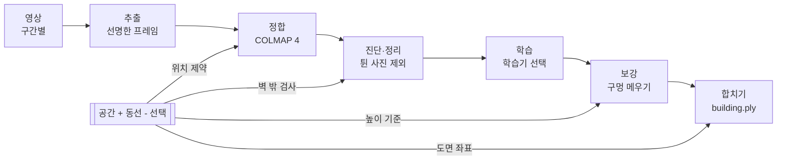
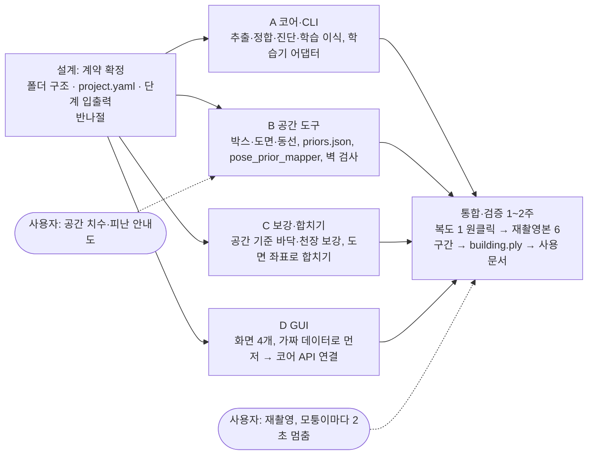

# IndoorGS 설계

2026-11-27 · 하지운

## 목표와 범위

영상만 넣으면 실내 공간(여러 방·복도)을 **한 건물 좌표의 VR용 스플랫**으로 만드는 Windows 도구를 만든다. 핵심 차별점은 도면·동선으로 카메라 위치를 잡아 주는 정합 보완과, 여러 구간을 도면 기준으로 자동으로 합치는 것이다.

**만드는 것**

- 원클릭 실행: 프레임 추출 → 정합 → 진단·정리 → 학습 → 보강 → 합치기 → 내보내기
- 공간 입력: 박스로 직접 만들기, 도면 파일·사진으로 초안 만들기
- 동선 그리기(선택): 브러시로 동선, 시간 고정점, 프레임별 위치 생성, 벽 밖 카메라 검사
- 학습기 교체 구조: 기본 Brush, 고화질 옵션 LichtFeld (나중에 gsplat)
- 결과 비교: PSNR, 반투명 비율, 위치 튄 사진 목록
- GUI(로컬 웹 UI)와 사용 문서

**만들지 않는 것**

- 자체 정합 엔진, 자체 학습기 (COLMAP·Brush·LichtFeld를 불러 씀)
- VR 뷰어, Unity 플러그인 (PLY를 내보내는 데까지)
- 야외·물체 스캔 최적화

**대상 사용자**: 실내 공간을 영상으로 찍어 게임·VR·전시에 쓰려는 사람. 처음에는 NoClip 팀, 다음에 공개(오픈소스·포트폴리오).

**성공 기준**: 재촬영본 6구간을 버튼 한 번으로 처리해서, 사람이 손대지 않고 한 건물 PLY가 나온다. 위치 튄 사진 0장, 구간 이음새가 도면과 10cm 안으로 맞는다.

## 재사용할 자산

코드의 대부분은 이 저장소(`5undura/3DGS`)에 이미 있다. 새 프로그램은 이것들을 모듈로 감싸고, 실험에서 검증된 값을 기본 설정으로 쓴다.

| 자산 | 지금 위치 | 새 모듈 | 상태 |
| --- | --- | --- | --- |
| 프레임 추출 (선명도 필터, 한글 경로) | `1_extract/pick_best.py` | extract | 사용 중 |
| COLMAP 4 정합 배치 | `2_register/register_all.ps1` | register | 사용 중, 파이썬으로 옮김 |
| 위치 튄 사진 진단 | `tools/diagnose.py` | diagnose | 사용 중, 자동 제외 추가 |
| 학습 배치 | `3_train/train_all.ps1`, `lfs_eval.ps1`, `brush_eval.ps1` | train | 학습기별 어댑터로 나눔 |
| 평가 (PSNR, 정렬 후 PSNR) | `tools/eval_renders.py`, `compare_eval.py` | evaluate | 사용 중 |
| 반투명·바늘형 통계 | `tools/ply_stats.py` | evaluate | 사용 중 |
| 빈 곳 채우기, 구멍만 바탕층 | `tools/fill/fill_section.py`, `merge_holes.py` | fill | 도면 입력 추가 |
| 부유물 정리 | `tools/fill/clean_section.py` | clean | 사용 중 |
| 구간 합치기·배치 | `place.py`, `tools/realign_layout.py`, `layout_v4.json` | merge | 도면 좌표로 대체 |
| 배경 메쉬·문 구멍 | `tools/fill/avt_backdrop.py` | export (선택) | Unity용, 나중에 |

**검증된 기본 설정** (복도 1, 3060 Ti, 같은 평가 사진 133장)

| 학습기 | 설정 | PSNR | 반투명 | 시간 |
| --- | --- | --- | --- | --- |
| Brush 0.3 | 1920px, 300만, SH2, 30,000회 | 25.75 | 86.9% | 36분 |
| LichtFeld 0.5.4.3 | 1920px, 300만, SH2, MRNF, `--pose-opt`, 80,000회 | 26.79 | 49.4% | 91분 |

효과 없던 것(2560px, 400만, global·incremental 재정합, 벽 바탕층 전체)은 기본값에서 뺀다. 근거는 `3_train/PROGRESS.md`.

## 전체 구조

프로젝트 폴더 하나가 건물 하나다. 모든 단계는 이 폴더에서 읽고 쓰며, 끝난 단계는 건너뛰어 중간에 끊겨도 이어서 실행된다. 코어는 Python, PowerShell 배치는 이 코어로 옮긴다.



공간 입력이 없으면 아래쪽 연결을 빼고 지금 파이프라인처럼 돌고, 합치기는 `layout.json` 수동 배치를 쓴다.

**프로젝트 폴더** (영문 경로 권장, COLMAP·OpenCV 한글 경로 문제)

```
my_building/
  project.yaml            설정 (아래)
  floorplan/
    plan.png              도면 이미지 (있으면)
    plan.json             방(바닥 다각형 + 높이), 문 (미터)
  sections/
    room_b117/
      path.json           동선과 시간 고정점
      frames/             1. 추출
      colmap/             2. 정합 (db.db, sparse/)
      data/               왜곡 보정 사진 + sparse/0 (학습 입력)
      diagnose.json       3. 진단 (위치 튄 사진, 벽 밖 카메라)
      train/brush_default/  4. 학습 (splat.ply, eval.json, stats.json)
      fill/               5. 보강 (holes_backdrop.ply)
  merged/
    building.ply          6. 합친 결과
  report.html             구간별 점수·그림 비교
  logs/
```

**설정 파일** `project.yaml` (예)

```yaml
tools:
  colmap: C:/tools/colmap/COLMAP.bat
  brush: C:/tools/brush/brush_app.exe
  lichtfeld: null            # 있으면 고화질 옵션 활성화
gpu_profile: 8gb             # 8gb / 12gb
sections:
  - name: corridor1
    video: D:/capture/1.MP4
  - name: room_b117
    video: D:/capture/5.MP4
extract: {min_diff: 4, sharp_ratio: 0.8}
register: {matcher: sequential, mapper: incremental, use_floorplan_prior: true}
train: {trainer: brush, preset: default}
fill: {holes_only: true}
```

## 단계별 입력·출력

각 단계는 같은 모양의 함수 `run(section, cfg) -> StageResult`로 만든다. 에이전트들은 이 표의 파일 이름만 지키면 서로 독립적으로 작업할 수 있다.

| 단계 | 입력 | 출력 | 끝났는지 판단 |
| --- | --- | --- | --- |
| extract | 영상, `extract` 설정 | `frames/*.jpg` (파일명에 원본 프레임 번호 = 시간) | jpg 1장 이상 + `frames/done.json` |
| prior (선택) | `plan.json`, `path.json`, 프레임 목록 | `colmap/priors.json` (프레임별 x, y, z, 불확실성 m) | priors.json |
| register | `frames/`, priors(있으면) | `colmap/db.db`, `colmap/sparse/N`, `data/` | `data/sparse/0` |
| diagnose | `data/`, `plan.json`(있으면) | `diagnose.json` (위치 튄 사진, 벽 밖 카메라, 재투영 오차) + 제외한 `data_clean/` | diagnose.json |
| train | `data_clean/`, 학습기·프리셋 | `train/<학습기>_<프리셋>/splat.ply`, `eval.json`, `stats.json` | splat.ply |
| fill | splat.ply, `data_clean/`, `plan.json`(있으면) | `fill/holes_backdrop.ply` | ply |
| merge | 구간별 최종 ply, 도면 좌표 또는 `layout.json` | `merged/building.ply`, `merged/layout.json` | building.ply |
| report | 모든 json | `report.html` | 항상 다시 만듦 |

**공통 규칙**

- 원본(영상, 이전 단계 결과)은 절대 덮어쓰지 않는다. 다시 돌리면 새 폴더(`train/brush_default_2`)로 만든다.
- 모든 좌표는 미터, 도면이 있으면 도면 좌표(바닥 = z 0).
- PLY는 속성 이름으로 읽는다. Brush는 xyz가 맨 뒤, LichtFeld는 맨 앞이라 순서로 읽으면 틀린다.
- 외부 도구 옵션 이름은 시작할 때 `--help`로 확인하고, 없으면 멈추고 알린다.

## 공간·동선 위치 기능

공간 모델 위에 그린 동선으로 프레임별 대략 위치(오차 수십 cm)를 만들고, COLMAP `pose_prior_mapper`(3.11부터)에 위치 제약으로 넣는다. 목표는 비슷한 복도끼리 잘못 연결되어 사진이 튀는 것을 막고, 결과를 처음부터 도면 좌표로 받는 것이다. 2px 수준의 미세 자세는 학습기 자세 보정이 맡는다.

**1. 공간 입력** (`plan.json`)

세 가지 방식 중 하나로 넣고, 결과는 같은 형식이다: 방 = 바닥 다각형 + 바닥·천장 높이, 문 = 위치·폭·높이 (미터).

| 방식 | 하는 일 | 난이도 | 순서 |
| --- | --- | --- | --- |
| 박스로 직접 만들기 | 방·복도를 직육면체로 놓고 크기·위치를 맞춤, 문은 면에 구멍. 도면 없이 줄자 치수만으로도 됨 | 쉬움 | 1순위 (최소 버전) |
| 도면 파일 (DXF·SVG·벡터 PDF) | 벽 선을 읽어 다각형으로, 축척은 파일 단위 또는 두 점 실측 | 중간 | 2순위 |
| 도면 사진 (피난 안내도 등) | 원근 보정 후 선 검출로 벽 후보를 그리고 사람이 고침. 글자·기호 때문에 완전 자동은 어려움 | 어려움 | 3순위 (반자동) |

박스 방식을 1순위로 두는 이유: 실내 대부분이 박스 조합이고, 처음부터 3D라 천장 높이까지 들어 있다. 같은 박스를 보강 면과 Unity 충돌체로도 재사용할 수 있다. 파일·사진 방식은 결국 박스 편집기에 초안을 올려 주는 기능이 된다.

**2. 동선 그리기 (선택)** (`path.json`)

- 브러시로 도면·박스 위에 걸어간 길을 대충 그림
- 시간 고정점: 영상을 재생하며 선 위 한 점을 클릭하면 "이 시간에 여기". 최소 시작·끝 2개, 모퉁이·문 앞에 더 찍을수록 정확
- 고정점 사이는 그린 선을 따라 일정한 속도로 배치 (직선 보간보다 실제 동선에 가까움). 멈춘 구간은 같은 점에 고정점 두 개
- 카메라 높이는 설정값(기본 1.4m), 각도는 넣지 않음
- 안 그리면 위치 제약 없이 기존 방식으로 정합하고, 결과 궤적만 도면에 겹쳐 보여줌 (벽 밖 검사는 그대로)
- 촬영 팁: 모퉁이·문 앞에서 2초 멈추면 고정점 찍기가 쉬움

**3. 위치 제약 넣기**

- 프레임 파일명의 원본 프레임 번호 → 시간 → 동선 위 위치
- COLMAP DB의 `pose_priors` 표에 직교 좌표(CARTESIAN)로 기록, 불확실성 기본 xy 0.5m / z 0.3m
- `pose_prior_mapper`로 정합. 표의 정확한 스키마와 옵션 이름은 설치된 COLMAP 4.2.1에서 `-h`로 확인해 고정
- 실패하거나 공간 입력이 없으면 기존 incremental `mapper`로 자동 전환

**4. 검사와 활용**

- 검사: 카메라가 방 다각형 밖, 제약 위치에서 1m 이상 떨어짐, 촬영 순서상 순간이동 → `diagnose.json`에 기록하고 제외
- 보강: 바닥·천장 높이로 구멍 채울 면을 정함 (지금은 점에서 추정해 벽 바탕층 80%가 어긋났음)
- 합치기: 모든 구간이 같은 도면 좌표라 `place.py` 변환이 필요 없음. 문에서 겹치는 구간끼리 미세 정렬만 함
- 보기: 도면 위에 최종 카메라 궤적을 그려 동선과 비교, 튀는 사진은 빨간색

## 학습기 플러그인

기본 학습기는 설치가 쉬운 Brush, 고화질이 필요하면 사용자가 따로 설치한 LichtFeld를 별도 exe로 불러 쓴다. 학습기는 같은 어댑터 규격만 맞추면 나중에 더 넣을 수 있다.

**어댑터 규격**

- `detect(cfg)`: exe가 있는지, 버전, `--help`에 필요한 옵션이 있는지
- `presets()`: 프리셋 이름 → 옵션 (예: `default`, `quality`, `fast`)
- `train(data_dir, out_dir, preset, gpu_profile)`: 백그라운드 실행, 진행률과 로그를 내보냄
- `result(out_dir)`: 최종 PLY 경로와 평가 사진 렌더 경로

| 학습기 | 라이선스 | 설치 | 자세 보정 | 기본 프리셋 | 역할 |
| --- | --- | --- | --- | --- | --- |
| Brush 0.3 | Apache 2.0 (배포 전 확인) | exe 하나 | 없음 | 1920, 300만, SH2, 30,000회 | 기본 |
| LichtFeld 0.5.4.3 | GPLv3 | 소스 빌드 (VS2022, CUDA 12.8, clang-cl) | `--pose-opt` | 1920, 300만, SH2, MRNF, 80,000회 | 고화질 옵션 |
| gsplat | Apache 2.0 | Python + PyTorch | `--pose_opt` | 미정 | 나중 후보 |

**원칙**

- LichtFeld 코드는 프로그램에 넣지 않는다. 사용자가 경로를 지정하면 프로세스로 실행만 한다.
- 빌드를 돕는 스크립트와 안내는 따로 제공한다 (우리가 겪은 빌드 문제들을 반영).
- Brush의 반투명 86.9%는 알려진 한계로 보고서에 표시하고, VR용이면 고화질 옵션을 권한다.

## GUI

CLI가 먼저고, GUI는 같은 코어를 부르는 로컬 웹 화면이다. 브라우저에서 `localhost`로 열리고, 공간 편집은 캔버스로 만든다. 후보는 FastAPI + 가벼운 프런트(편집기 때문에 Gradio보다 자유도가 필요).

**화면 4개**

1. **프로젝트**: 폴더 열기·만들기, 도구 경로 자동 찾기와 점검(없는 것을 빨간색으로), 구간 추가(영상 끌어놓기)
2. **공간**: 박스 편집기(위에서 보기 + 3D 미리보기), 도면 파일·사진으로 초안 만들기, 브러시로 동선 그리기. 오른쪽에 영상 플레이어, 재생 중에 동선을 클릭하면 그 시간의 고정점이 찍힘
3. **실행**: 구간 × 단계 격자(대기·진행·끝·실패), 학습기·프리셋 선택, "전체 실행" 버튼, 로그 창. GPU 작업은 한 번에 하나씩 대기열로
4. **결과**: 도면 위 카메라 궤적(튀는 사진 빨간색), 구간별 PSNR·반투명 표, 평가 사진 vs 렌더 비교, PLY 열기(SuperSplat로 넘기기)

화면 시안은 구현 전에 따로 만들어 확인한다.

## 에이전트 분담과 일정

코드 초안은 에이전트 4개로 2~4일, 실제로 쓸 수 있는 수준까지는 약 2~3주로 추정한다. 병목은 코드가 아니라 GPU 한 대와 재촬영·도면 확보다.



각 에이전트는 자기 모듈 폴더만 고치고, 다른 모듈은 「단계별 입력·출력」 표의 파일로만 주고받는다. GPU를 쓰는 검증은 A가 맡아 한 번에 하나씩 돌린다.

## 위험 요소와 결정이 필요한 것

| 위험 | 영향 | 대응 |
| --- | --- | --- |
| 위치 제약으로는 2px 수준 자세 오차가 안 줄어듦 | 화질(PSNR) 개선은 작을 수 있음 | 목표를 "튀는 사진 0장, 자동 합치기"로 두고, 미세 보정은 학습기에 맡김 |
| `pose_prior_mapper`가 정합을 처음부터 다시 함 | 기존 incremental보다 느리거나 결과가 다를 수 있음 | 복도 1에서 기존 정합과 나란히 비교, 나쁘면 사후 검사·정렬에만 공간 정보 사용 |
| Brush 기본값의 반투명 86.9% | VR에서 비침 | 보고서에 경고, 고화질 옵션 안내 |
| LichtFeld 빌드 난이도 | 일반 사용자는 고화질 옵션을 못 씀 | 빌드 스크립트 제공, 나중에 gsplat 검토 |
| GPU 한 대(3060 Ti) | 검증이 느림 (LichtFeld 구간당 1.5시간) | 개발 중에는 짧은 학습(5,000회)으로 파이프라인만 확인 |
| 재촬영·도면이 아직 없음 | 공간 기능 검증이 늦어짐 | 박스 입력(줄자 치수) + 기존 4차 영상으로 먼저 시험 |

**결정이 필요한 것**

- [x] 프로그램 이름: IndoorGS
- [ ] 저장소: 새 저장소 vs `5undura/3DGS` 확장 (계획서는 지금 이 저장소 `docs/`)
- [ ] 공개 라이선스 (MIT / Apache 2.0 등)
- [ ] 학생회관 지하 공간 치수·도면 확보 방법 (줄자 실측 vs 시설팀 도면 vs 피난 안내도 사진)
- [ ] GUI 프런트 기술 (단순 HTML+JS vs React), 3D 미리보기 라이브러리 (three.js 등)
